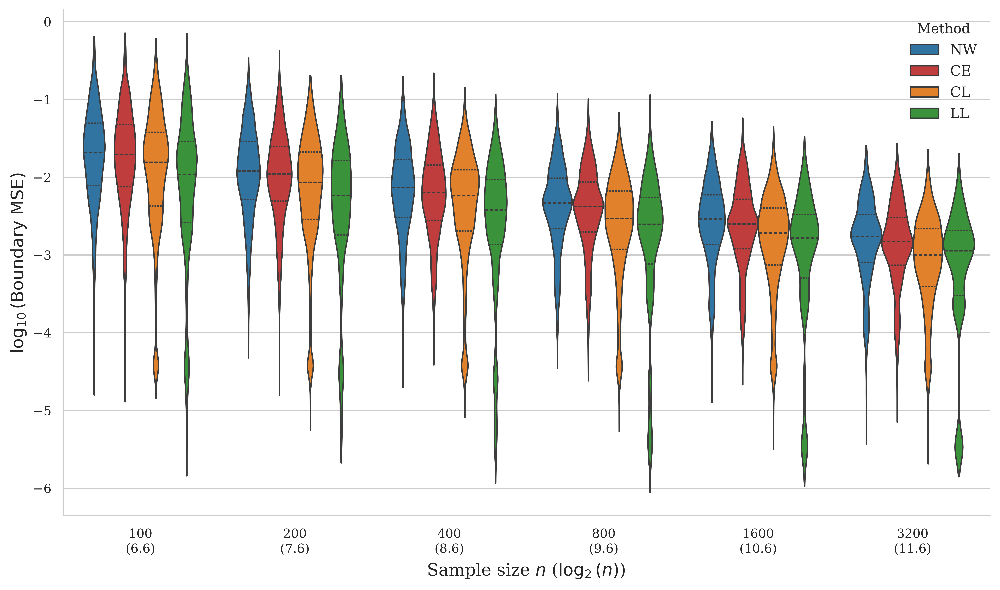
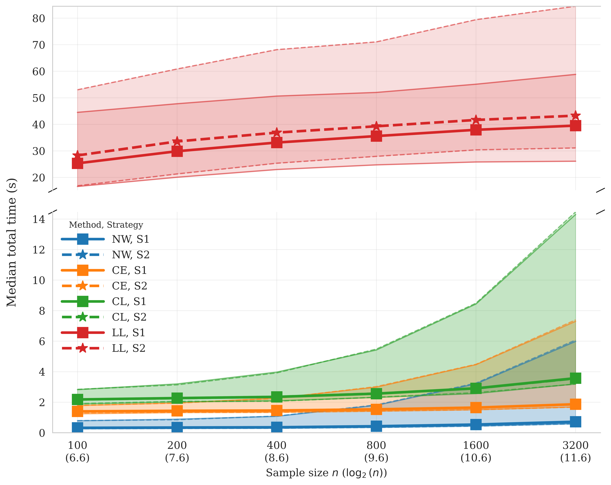
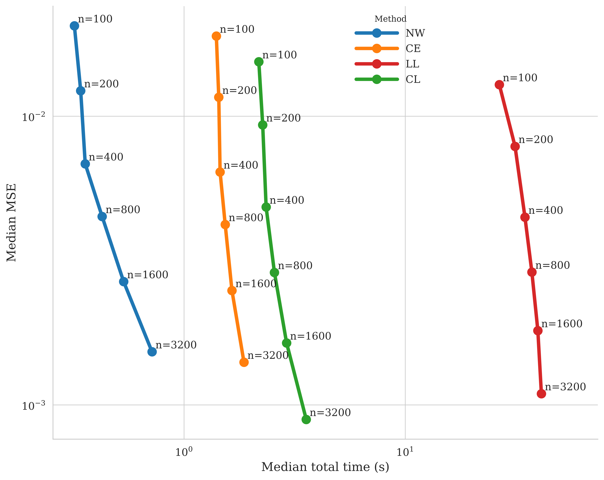
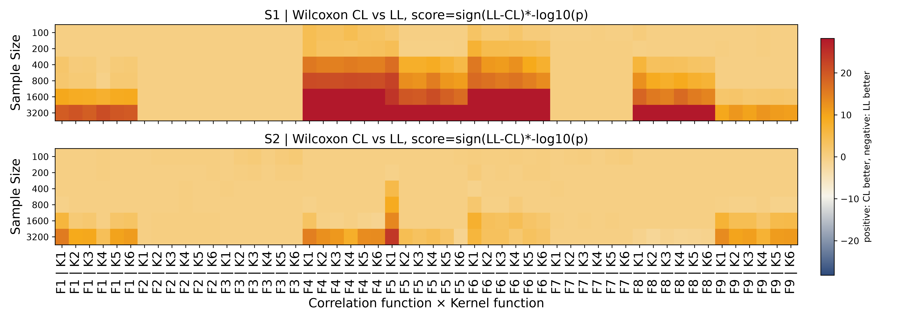
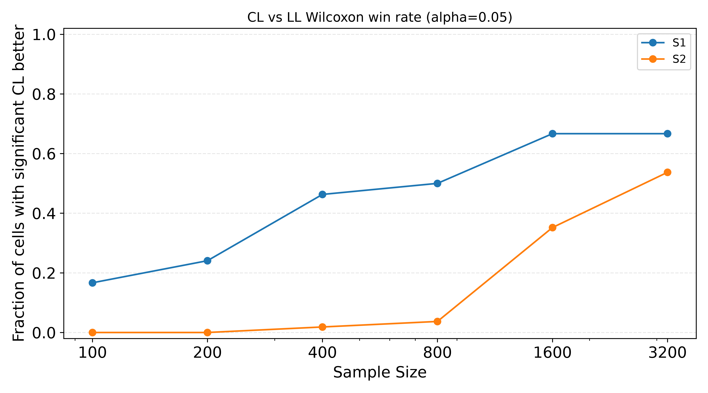

# Nonparametric Correlation Estimator

This repository contains implementations and tools for estimating nonparametric correlations using various methods, including Nadaraya-Watson, Local Linear, Cubic Equation, and Cubic with Local Linear Correction. It includes Monte Carlo simulation studies comparing these estimation methods across different sample sizes, as well as real data analysis applying the methods to MEG data from the CamCAN dataset to investigate brain network rhythmicity and connectivity patterns.

## Simulation Study

To conduct the simulation study, you can use the provided Python scripts to run Monte Carlo comparisons of the different estimation methods. The main script for this purpose is `compare_estimation_method.py`, which allows you to specify the number of repetitions, sample sizes, and other parameters for the simulation. For example:

```bash
cd nonparametric_correlation_estimator_cubic
python Python/compare_estimation_method.py
	--n 100 200    \
	--n_repeats 2   \
	--h_grid_num 50   \
	--number_test 50   \
	--n_jobs 2   \
	--correlation_function cubic   \
	--kernel_function epanechnikov   \
	--sampling_strategy uniform   \
	--seed 42   \
	--verbose 0   \
	--h_grid_start -3   \
	--h_grid_end 0   \
	--output_file Results/test_run.pkl
```

The above command runs a test simulation with the specified parameters:
- n (sample sizes) is set to 100 and 200,
- the number of Monte Carlo repetitions is 2,
- the number of grid points for bandwidth selection is 50,
- the number of test points is 50,
- 2 parallel jobs are used,
- the correlation function is cubic,
- the kernel function is Epanechnikov,
- the sampling strategy is uniform,
- the random seed is 42,
- verbosity is set to 0,
- the bandwidth grid starts at -3 and ends at 0,
- and the results are saved to `Results/test_run.pkl`.

Users can modify the parameters in the command above to suit their specific simulation needs.

To completely replicate the simulation study, run the bash script `run_all_experiments.sh` from the root directory of the repository

```bash
# before running the following command, ensure that you have activated the 'cubic' conda environment.
# If you did not have one, please create an environment named 'cubic' with the required dependencies.
# This ensures that all necessary dependencies for running the experiments are available.

cd nonparametric_correlation_estimator_cubic
bash run_all_experiments.sh
```

Note that running the full set of experiments may take a significant amount of time depending on your system's computational resources. Ensure that you have sufficient memory and processing power to handle the parallel execution of multiple simulations. The results cost about 5 days on an Ubuntu server with 32 CPU cores and 256 GB of RAM.

There will be 6x9x2 = 108 different combinations of correlation functions, kernel functions, and sampling strategies to be evaluated in the full simulation study. The names of the results are formatted in the pattern:

```python
 `f{correlaiton function}_{kernel function}_{sampling strategy}_results.pkl'
```

Please contact with the corresponding author for any questions or requests regarding the 108 results.

### Extract Combined Results

In this step, we extract and combine the results from all individual simulation runs into a single DataFrame for further analysis. We use the `load_combine_simulation_mse.py` script to accomplish this.

```bash
cd Python
python load_combine_simulation_mse.py
```

This will generate a combined DataFrame named `Results/combined_results_summary.csv` contaning columns: corr_fun, kernel, sample_strategy, method, sample_size, rep_idx, mse, mse_b, h_opt, time_bandwidth, time_u_test.

### Generate Figure 2 in the Paper

To generate Figure 2, which shows the distribution of log10(MSE) versus sample size for different methods and sampling strategies, use the `plot_sample_size_vs_mse.py` script:

```bash
cd Python
python plot_sample_size_vs_mse.py
```

It will save the generated figure to `figs/sample_size_vs_mse.png`.


### Generate Figure 3 in the Paper

To generate Figure 3, use the `plot_sample_size_vs_mse_boundary.py` script:

```bash
cd Python
python plot_sample_size_vs_mse_boundary.py
```

It will save the generated figure to `figs/sample_size_vs_mse_boundary.png`.




### Generate Figures 4 and 5 in the Paper

To generate Figures 4 and 5, use the `plot_time_sns.py` script:

```bash
cd Python
python plot_time_sns.py
```

It will save the generated figures to `figs/` as follows:




and


Similarly, to generate the MSE heatmap shown in Figure 1 of the online supplementary material, use the `plot_mse_sns.py` script


### Generate the results in Table 1 of the Paper

To generate the results in Table 1, which summarizes the efficiency rankings of different methods based on MSE and dual criteria, use the `plot_simulation_mse.py` script:

```bash
cd Python
python plot_simulation_mse.py
```

This will generate the `Results/deep_eff_rank_matrix.csv` file containing the efficiency rankings.


### Generate Wilcoxon Test Results

To generate the Wilcoxon test results, use the `plot_wilcoxon_test.py` script:

```bash
cd Python
python plot_wilcoxon_test.py
```

It will save the generated figures to the `figs/` directory, including the heatmaps and significance rate plots as follows:





## Real Data Analysis

In this study, we applied CL method to only one subject (ID:sub-CC110033) from CamCAN dataset. Please follow the [instructions on the online dataset](https://cam-can.mrc-cbu.cam.ac.uk/dataset/). Because we do not have the right to redistribute CamCAN data, please download it yourself.

After downloading, please create a folder named `MEG-PEC` and establish three subfolders: `emptyroom`, `freesurfer`, and `meg`, and place the downloaded data in the corresponding folders. Please note that we used FreeSurfer 8.1 to process the MRI data.

Then modify the corresponding paths in the `Python/power_envelope_schaefer200_global_symmetric_dfreq_none.py` script.

```bash
data_dir = "/path/to/MEG-PEC"
subjects_dir = "/path/to/MEG-PEC/freesurfer"
out_dir = "/path/to/Projects/nonparametric_correlation_estimator_cubic/Results"
```

Run the `Python/power_envelope_schaefer200_global_symmetric_dfreq_none.py` script to obtain the power envelope results. The output file is named: `Results/power_envelope_{band}_dfreq_none.npy`.

Then use the `Python/local_bandwith_cpu_CL_all_bands.py` script to select the local bandwidth for each frequency band. The results will be saved in the `Results/bandwidths_{band}_dfreq_none.npy` file.

Next, run the `Python/calculate_correlation_matrix.py` script to calculate the dynamic correlation matrix for each frequency band. The results will be saved in the `Results/dynamic_corr_{band}.npy` file.

Finally, execute the `Python/get_eigvar_yeo7_network.py` script to calculate the eigenvalue variance and Yeo-7 network for each frequency band. The results will be saved in the `Results/eigvar_yeo7_network_{band}.npz` file. All the intermediate results are stored on the server up to 10 GB. To save the space in the repository, we only offer the results of `eigvar_yeo7_network_{band}.npz` for generating the Figures 7, 8 and 9 in the paper. For more details, please contact the corresponding author.

### Generate the Figures 7 and 8 in the Paper

```bash
cd Python
python plot_eig_var_with_circle_connect_new.py
```

It will save the generated figures to `figs/` as follows. For example:


### Generate the Figure 9 in the Paper

run the following command to generate Figure 9:

```bash
cd Python
python rhythmicity_analysis_new.py
python plot_rhythmicity.py
```

It will save the generated figure to `figs/` as follows:


